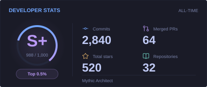
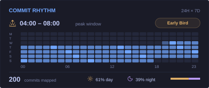
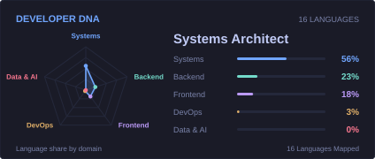
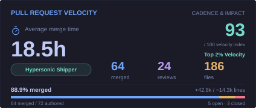
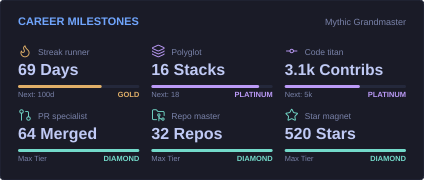

# GitStats

SVG cards for your GitHub profile, generated by a native **Zig 0.16.0** engine. **GitStats Studio** lets you arrange, preview, and export your layout in the browser.

[](https://github.com/adityapandeydev/git-stats/actions/workflows/checks.yml)
[](https://ziglang.org/)
[](LICENSE)

[Get started](#get-started) · [Cards](#cards) · [Local development](#local-development) · [CLI reference](docs/cli.md) · [Studio and Pages guide](frontend/README.md)

## How it works

1. **Design in Studio.** Choose cards, themes, dimensions, and layout. The browser runs the same Zig SVG renderers through WebAssembly; GitHub data fetching happens in JavaScript.
2. **Save a workflow to your fork.** Export the YAML manually, or use Studio's direct sync with a write token.
3. **Generate on GitHub Actions.** A runner builds the native executable, fetches your data, renders SVGs, and commits them to `generated/`.
4. **Embed in your profile.** Copy the exported image markup into your separate `username/username/README.md`.

Studio is a static site, and the engine is a CLI, so no continuously running backend server is needed. Studio commits the **workflow**, not generated images or your profile README. GitHub Actions generates the images afterward.

## Get started

1. **Fork this repository** and enable Actions in your fork.
2. **Choose your setup:** use Studio's visual editor, or edit [.github/workflows/generate-stats.yml](.github/workflows/generate-stats.yml) directly. The checked-in workflow contains this project's own card selection and language exclusions; adjust them for your profile.
3. **Add a read token** as **Settings → Secrets and variables → Actions → New repository secret → `GH_TOKEN`** for authenticated profile data. Give it access to the repositories you want included.
4. **Save the workflow** to `.github/workflows/generate-stats.yml`, then run it from the **Actions** tab. Workflows exported by Studio run every four hours and can also be started manually.
5. **Check that generation succeeds**, then paste the README snippet from Studio into your profile repository. Replace the owner, repository, and branch in any hand-written URLs.

For example, embed an individual card with:

```html

```

For a complete layout, use Studio's **Export → Profile README**. Its **Profile preview** renders the exported markup with local SVGs before you deploy. GitHub's available README width and image cache can affect wrapping and update timing.

### Which token goes where?

| Purpose | Where it goes | Access |
| --- | --- | --- |
| Authenticated preview | Studio → Connect GitHub | Read access to the profile repositories |
| Optional direct sync | Studio → Deploy profile | Temporary fine-grained PAT restricted to your engine fork, with Contents, Workflows, and Actions write permissions |
| Scheduled data fetching | Fork's Actions secret `GH_TOKEN` | Separate, longer-lived read token for the repositories included in your stats |

Manual export needs no write token. Studio keeps tokens in tab memory, not saved drafts or exports. It does not create your fork, set Actions secrets, or edit your profile README. Actions uses its own repository token to commit SVGs.

Public language previews work without authentication; contribution and other profile metrics need an authenticated preview. Studio-exported workflows fall back to the repository's workflow token if `GH_TOKEN` is missing, but that token does not grant access to unrelated private repositories. The checked-in personal generation workflow currently passes only the `GH_TOKEN` secret; configure it before using that workflow for authenticated cards.

See the [Studio guide](frontend/README.md#tokens-and-deployment) for permission boundaries, data limits, and deployment steps.

## Cards

The standalone non-language previews below use deterministic **sample data**, not a live account. All cards have a configurable corner radius; the default is **4.5px**.

| Card | What it shows | Preview |
| --- | --- | --- |
| Languages | GitHub language colors, percentage breakdown, exclusions, and dynamic row spacing | [Standard](preview/languages/standard.svg), [donut](preview/languages/donut.svg), [compact](preview/languages/compact.svg) |
| Streak | Current and longest streaks, complete date ranges, and optional 14-day momentum | [Without momentum](preview/streak/minimal.svg) |
| Stats | Craft grade, score-based progress ring, commits, merged PRs, stars, and repositories | [SVG](preview/stats/standard.svg) |
| Rhythm | 168-cell weekly activity map, peak window, persona, and day/night balance | [SVG](preview/rhythm/standard.svg) |
| Developer DNA | Five-domain radar chart, language shares, and developer archetype | [SVG](preview/radar/standard.svg) |
| PR velocity | Merge turnaround, PR outcomes, shipped code, reviews, and velocity score | [SVG](preview/velocity/standard.svg) |
| Milestones | Six achievements with rank tiers and progress; compact and wide layouts | [SVG](preview/milestones/standard.svg) |

| Contribution streak | Developer stats |
| :---: | :---: |
|  |  |

| Commit rhythm | Developer DNA |
| :---: | :---: |
|  |  |

| PR velocity | Career milestones |
| :---: | :---: |
|  |  |

Studio offers eight palettes, drag-and-drop ordering, quick arrangement controls, a right-hand languages pillar, sequential flow, and per-card settings. The native CLI also supports unified **bento SVGs**, additional language layouts, and additional themes; see [CLI reference](docs/cli.md).

## Local development

Use **Node 24** for Studio and **Zig 0.16.0** for native or WebAssembly builds. From PowerShell:

```powershell
cd frontend
npm ci
npm run dev
```

Open the localhost URL Vite prints, normally **http://localhost:5173/**. Ordinary React/CSS development uses the checked-in `engine.wasm` and does not require compiling Zig first. After changing a Zig renderer, run `npm run engine` and refresh Studio.

To build the native engine, run this from the repository root:

```powershell
zig build -Doptimize=ReleaseFast
```

For all checks and production builds, see [verification](frontend/README.md#verification). To host Studio, follow [GitHub Pages setup](frontend/README.md#github-pages). Deploying the static Studio and generating profile SVGs are separate workflows.

## Repository map

| Path | Responsibility |
| --- | --- |
| `src/github/` | GitHub client, data models, analytics, and language colors |
| `src/renderer/` | Shared SVG card renderers, themes, and bento composition |
| `src/main.zig` | Native CLI entry point |
| `src/studio.zig` | Browser WebAssembly entry point |
| `frontend/` | React Studio, workflow compiler, tests, and build scripts |
| `generated/` | Published profile SVGs produced by Actions |
| `preview/` | Documentation examples and bento layout gallery |
| `.github/workflows/` | Profile generation, Pages deployment, and project checks |

Existing CLI flags remain compatible. Studio exports opt into `--strict-data`, `--svg-icons`, and `--animate=false` for explicit data failures and matching static previews. Existing workflows retain their configured behavior. Metrics reflect GitHub visibility and bounded API sampling; tier percentiles are heuristic labels, not measured platform-wide rankings.

## License

[MIT](LICENSE). Lucide icon paths use the [ISC license](https://github.com/lucide-icons/lucide/blob/main/LICENSE).
