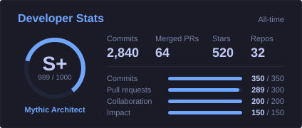
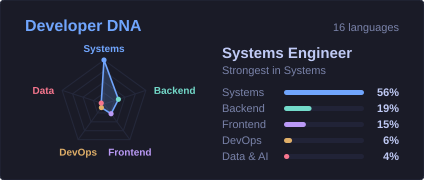
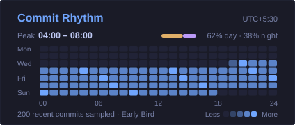

# GitStats

**Live stat cards for your GitHub profile.** Design a layout in your browser, publish it once, and your cards refresh themselves every four hours.

[](https://github.com/adityapandeydev/git-stats/actions/workflows/checks.yml)
[](LICENSE)

<p align="center">
  
  
  <br/>
  
</p>
<p align="center">
  
  
</p>

<sub>Examples use sample data.</sub>

## Get started

No installs, no fork, and no token required.

1. **Open [GitStats Studio](https://adityapandeydev.github.io/git-stats/)** and enter your GitHub username.
2. **Design.** Drag cards into rows, pick a theme, and check how it looks on desktop and phone.
3. **Publish.** Studio opens GitHub with one workflow file already filled in. Click **Commit changes**.

Your cards appear on your profile a minute or two later.

You need a **profile repository**: a public repository named exactly like your username (for example `octocat/octocat`). GitHub shows its README on your profile. Studio links to create one if you don't have it yet.

### What gets added to your profile repository

| File | Purpose |
| --- | --- |
| `.github/workflows/gitstats.yml` | Runs every four hours. Holds your layout and settings. |
| `gitstats/*.svg` | Your cards, redrawn on every run. |
| `README.md` | Only the section between `<!-- gitstats:start -->` and `<!-- gitstats:end -->` is updated. The rest stays exactly as you wrote it. |

To change your design later, open Studio (your last design is saved in your browser), adjust it, and commit the new workflow from the Publish step.

## Do I need a token?

| You want to… | Token |
| --- | --- |
| Show cards with your public activity | **None.** The workflow uses GitHub's built-in token. |
| Count private repositories and contributions | A read-only token saved as the secret `GH_TOKEN` in your profile repository. [Step-by-step guide](https://adityapandeydev.github.io/git-stats/#/docs/tokens) |
| Preview every card with your own data in Studio | Optional read-only token, kept in your browser tab only. |

## Cards

| Card | Shows |
| --- | --- |
| **Contribution streak** | Current and longest streak, total contributions, and the last 14 days |
| **Developer stats** | A score out of 1000, the four parts it's made of, and headline totals |
| **Top languages** | Your most used languages by code size, with hidden languages and skipped repositories |
| **Developer DNA** | How your code splits across Systems, Backend, Frontend, DevOps and Data & AI |
| **Commit rhythm** | When you commit, by weekday and hour, in your timezone |
| **Pull requests** | Merge time, merge rate, outcomes and the size of recent work |
| **Milestones** | Six achievements with Bronze-to-Diamond tiers and progress to the next one |

Card layouts use percentage widths, so rows shrink together on small screens instead of wrapping. Nine themes are available, including GitHub Light.

## How it works

```
GitStats Studio (static site)          Your profile repository
  design → workflow file  ──commit──▶  .github/workflows/gitstats.yml
                                              │ every 4 hours
                                              ▼
                                       uses: adityapandeydev/git-stats  (this repo's Action)
                                         builds the Zig engine, fetches your data,
                                         writes gitstats/*.svg and your README section
```

The cards are drawn by a native **Zig 0.16.0** engine. Studio runs the same renderers compiled to WebAssembly, so the preview matches the published cards exactly. Nothing runs on a server.

## Documentation

- **[Studio docs](https://adityapandeydev.github.io/git-stats/#/docs)**: getting started, cards, layout, tokens, troubleshooting
- **[CLI reference](docs/cli.md)**: run the engine yourself, all flags, bento grids
- **[Studio development](frontend/README.md)**: run, build and deploy the website

Workflows that call the CLI directly, including ones exported by earlier versions of Studio, keep working.

## Develop

```powershell
# Engine
zig build -Doptimize=ReleaseFast
zig build test

# Studio
cd frontend
npm ci
npm run dev
```

| Path | Responsibility |
| --- | --- |
| `src/github/` | GitHub client, data models and analytics |
| `src/renderer/` | SVG card renderers and themes |
| `src/main.zig`, `src/studio.zig` | Native CLI and WebAssembly entry points |
| `action.yml`, `action/` | The GitHub Action used by published workflows |
| `frontend/` | GitStats Studio |
| `preview/` | Sample images for documentation |
| `generated/` | This project owner's own profile cards |

## License

[MIT](LICENSE). Lucide icon paths use the [ISC license](https://github.com/lucide-icons/lucide/blob/main/LICENSE).
